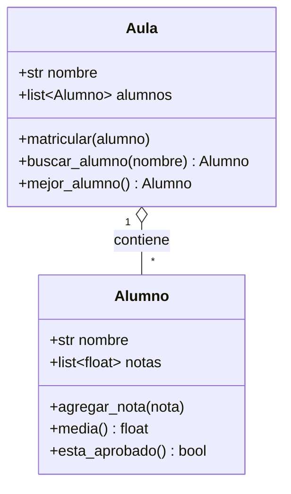
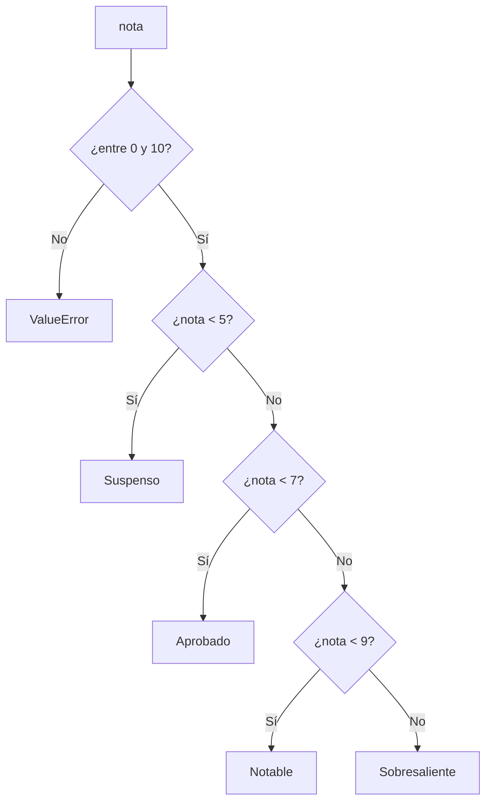
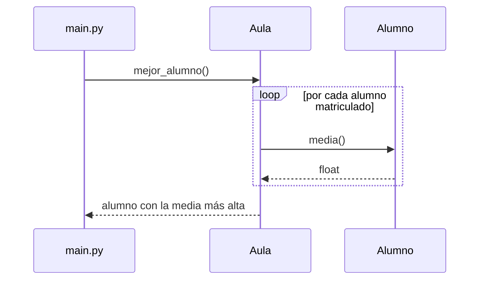

# Diagramas

Los diagramas se escriben como texto con [Mermaid](https://mermaid.js.org/) y se dibujan al generar la web. Al ser texto, se versionan con Git igual que el código.

## Diagrama de clases

Muestra las clases del módulo, sus atributos, métodos y cómo se relacionan.

## Diagrama de flujo: `clasificar_nota`

Describe la lógica de decisión de la función.

## Diagrama de secuencia: `mejor_alumno`

Muestra qué objetos intervienen y en qué orden cuando se pide el mejor alumno del aula.

